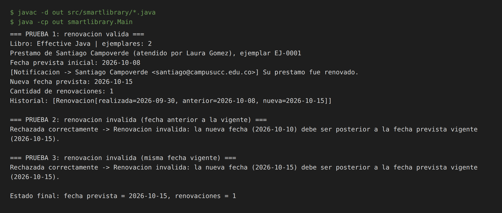
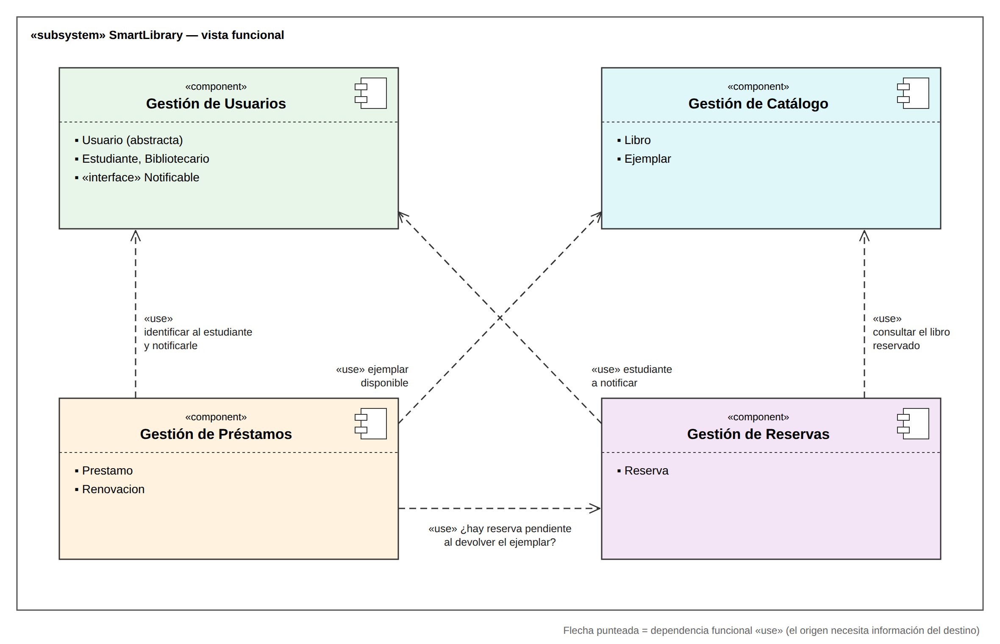
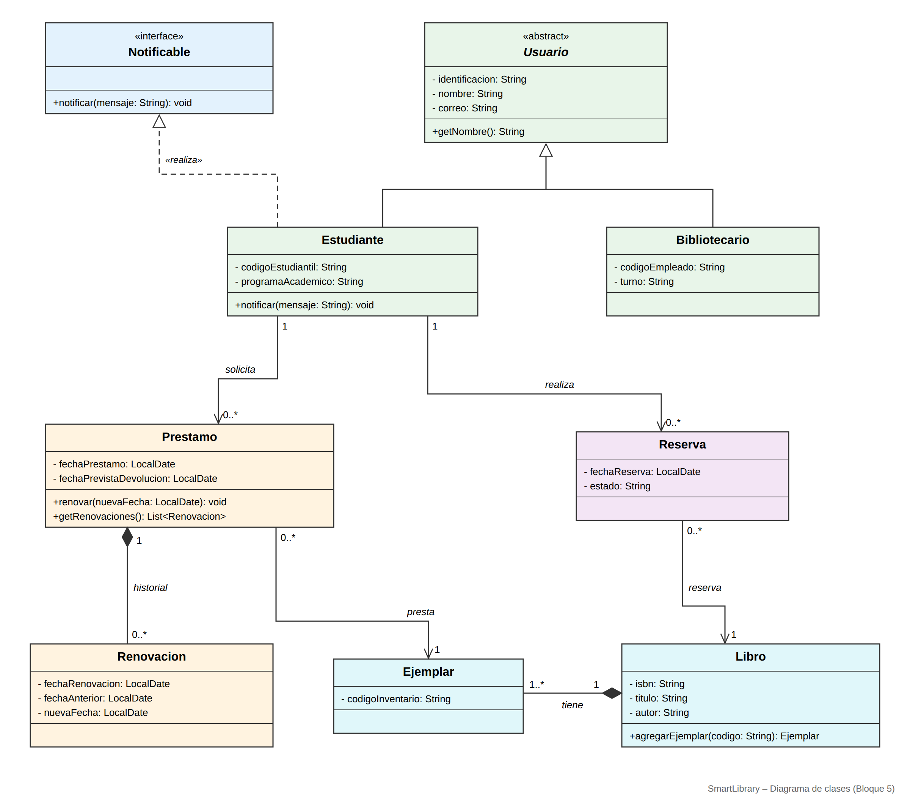

# SmartLibrary – Taller Práctico Bloque 5
**De clases aisladas a objetos que colaboran**
Diseño de Software · Universidad Cooperativa de Colombia

| Dato | Información |
|---|---|
| Caso conductor | SmartLibrary |
| Integrantes | _(completar con los nombres del equipo)_ |
| Herramientas | Diagramas UML (SVG/PNG) + Java 17+ |

## Estructura del repositorio

```
smartlibrary-bloque5/
├── README.md                  ← justificaciones, tablas y conclusión
├── src/smartlibrary/          ← código Java
│   ├── Notificable.java       (interfaz)
│   ├── Usuario.java           (abstracta)
│   ├── Estudiante.java        (extends Usuario implements Notificable)
│   ├── Bibliotecario.java     (extends Usuario)
│   ├── Libro.java / Ejemplar.java
│   ├── Prestamo.java / Renovacion.java
│   └── Main.java              (pruebas: renovación válida e inválidas)
├── diagramas/
│   ├── clases.png / clases.svg
│   └── componentes.png / componentes.svg
└── evidencias/
    ├── ejecucion.png
    └── salida_ejecucion.txt
```

**Compilar y ejecutar**

```bash
javac -d out src/smartlibrary/*.java
java -cp out smartlibrary.Main
```

---

## Actividad 1 – Diagnóstico de relaciones

| Elementos | ¿Qué relación existe en el problema? | ¿Existencia independiente? | Decisión inicial |
|---|---|---|---|
| Estudiante – Préstamo | Un estudiante solicita préstamos; un préstamo siempre pertenece a un estudiante. Colaboran, pero ninguno es "parte" del otro. | Sí. El estudiante existe sin préstamos; el préstamo es un hecho propio (con fechas y reglas) que no es un componente del estudiante. | Asociación |
| Libro – Ejemplar | Un libro (obra) tiene varios ejemplares físicos; cada ejemplar corresponde a un único libro (R10). Hay relación todo–parte. | No, en SmartLibrary un ejemplar es "una copia de *ese* libro": sin su libro pierde significado y nunca cambia de libro. | Composición (con supuesto documentado) |
| Préstamo – Renovación | El préstamo registra su historial de renovaciones (R11). | No. Una renovación sólo tiene sentido dentro del préstamo que renueva. | Composición |
| Usuario – Estudiante | Un estudiante **es un** usuario de la biblioteca. | No aplica (no son dos objetos; es clasificación). | Generalización (herencia) |
| Usuario – Bibliotecario | Un bibliotecario **es un** usuario de la biblioteca. | No aplica. | Generalización (herencia) |

**Preguntas de discusión**

1. **¿Que dos clases se relacionen significa que una sea parte de la otra?** No. La mayoría de relaciones sólo expresan que los objetos se conocen o colaboran (asociación). "Ser parte de" exige una relación todo–parte real y, para composición, además dependencia del ciclo de vida.
2. **¿Qué evidencia del requisito usamos?** R10 ("cada ejemplar corresponde a un único libro"), R11 ("un préstamo registra las renovaciones": el historial es del préstamo) y R12 ("estudiantes y bibliotecarios comparten identificación, nombre y correo, pero poseen información particular" + ambos son "usuarios de biblioteca").
3. **¿Cuál sería incorrecto decidir sólo por los nombres?** Libro–Ejemplar y Estudiante–Préstamo. Por el nombre, "un estudiante tiene préstamos" suena a composición, pero el préstamo no es parte del estudiante. Y Libro–Ejemplar puede ser agregación o composición según el ciclo de vida que defina el dominio, no según el nombre.

---

## Actividad 2 – Asociación, agregación y composición

Ver fragmento en el diagrama de clases (`diagramas/clases.png`).

| Relación | Tipo seleccionado | Multiplicidad | Justificación basada en el dominio |
|---|---|---|---|
| Estudiante – Prestamo | **Asociación** dirigida | Estudiante `1` — `0..*` Prestamo | El préstamo necesita saber a quién se prestó; el estudiante existe antes y después de cualquier préstamo. Borrar un estudiante no "destruye" conceptualmente los préstamos (quedan como historial de la biblioteca) y el préstamo no es una pieza del estudiante. |
| Prestamo – Ejemplar | **Asociación** dirigida | Prestamo `0..*` — `1` Ejemplar | Un préstamo presta exactamente un ejemplar; un ejemplar puede aparecer en muchos préstamos a lo largo del tiempo. El ejemplar existe en la estantería independientemente de que esté prestado: no es parte del préstamo. |
| Libro – Ejemplar | **Composición** | Libro `1` ◆— `1..*` Ejemplar | R10: cada ejemplar corresponde a un único libro y no puede reasignarse. **Supuesto:** en SmartLibrary el ejemplar es la representación de una copia *de ese libro* en el catálogo; si el libro se da de baja del catálogo, sus ejemplares también. En el código, sólo `Libro.agregarEjemplar()` crea ejemplares (constructor de paquete) y el campo `libro` del ejemplar es `final`. *Alternativa válida:* si la biblioteca quisiera conservar ejemplares como inventario físico aunque el libro se retire del catálogo, sería **agregación**. |
| Prestamo – Renovacion | **Composición** | Prestamo `1` ◆— `0..*` Renovacion | La renovación es parte del historial interno del préstamo (R11), sólo la crea el propio préstamo en `renovar()` y no tiene sentido ni identidad fuera de él: si el préstamo desaparece, su historial también. Se expone como lista de sólo lectura. |

**Reto de razonamiento:** el punto abierto es Libro–Ejemplar. Nuestra decisión (composición) se apoya en el supuesto de que el ejemplar no tiene vida en el sistema sin su libro. Si el enunciado dijera que los ejemplares se conservan como inventario aunque el libro se retire, cambiaríamos a agregación.

---

## Actividad 3 – Herencia: ¿es-un o sólo se parecen?

1. **¿Estudiante es realmente un tipo de Usuario?** Sí. En SmartLibrary el estudiante se identifica, consulta, solicita préstamos y reservas como **usuario de la biblioteca** (R12). En cualquier lugar donde el sistema espere un `Usuario` (por ejemplo, identificar a alguien por su identificación o correo) puede usarse un `Estudiante` sin romper el significado → cumple el «es-un».
2. **¿Bibliotecario es realmente un tipo de Usuario?** Sí. El bibliotecario también es un usuario de SmartLibrary (se identifica y opera el sistema) y R12 lo nombra explícitamente así. Tiene datos propios (`codigoEmpleado`, `turno`) que lo especializan.
3. **¿Repetir identificación, nombre y correo es suficiente para crear `Usuario`?** No. Compartir atributos es una **consecuencia**, no la razón. La superclase se justifica porque `Usuario` es un concepto real del dominio ("usuarios de biblioteca") y ambas especializaciones son tipos de él. `Usuario` se declara **abstracta** porque no existe un usuario que no sea estudiante ni bibliotecario.
4. **Situación en la que una superclase sólo para evitar atributos repetidos sería débil:** `Libro` y `Usuario` tienen ambos un identificador y un nombre/título. Crear `EntidadConNombre` y hacer que `Libro extends EntidadConNombre` y `Usuario extends EntidadConNombre` es incorrecto: un libro **no es** un usuario ni comparten comportamiento, y cualquier cambio en la superclase afectaría a conceptos que no tienen nada que ver. Otro ejemplo: `Bibliotecario extends Estudiante` "porque ya tiene nombre y correo".

**Decisión:** la generalización es válida y se incluye en el diagrama (`Usuario` abstracta ◁— `Estudiante`, `Bibliotecario`).

---

## Actividad 4 – Interfaces: expresar un contrato

```java
public interface Notificable {
    void notificar(String mensaje);
}
```

**¿Qué clases implementan `Notificable`?** Sólo **`Estudiante`**. R13 dice que *algunos* usuarios reciben notificaciones; las notificaciones del sistema (renovación de préstamo, reserva disponible, vencimiento) van dirigidas a quien tiene el préstamo o la reserva, es decir, al estudiante. El bibliotecario es quien opera el sistema, así que en este bloque **no** implementa la interfaz. Por eso no se pone en `Usuario`: si fuera así, *todos* los usuarios quedarían obligados, contradiciendo R13. Si mañana se exige notificar a los bibliotecarios, basta con agregar `implements Notificable` sin tocar la jerarquía.

En UML se representa como `«interface» Notificable` con una **realización** (línea punteada con triángulo hueco) desde `Estudiante`.

**¿Qué garantiza y qué NO especifica el contrato?**
- *Garantiza:* que cualquier objeto `Notificable` acepta el mensaje `notificar(String)`; quien lo use puede notificarle sin saber de qué clase concreta es.
- *No especifica:* el medio (consola, correo, SMS, app), el formato, si la entrega es inmediata, si se guarda un registro ni qué pasa si falla. Eso lo decide cada clase que lo implementa.

**¿Por qué una interfaz no equivale a una superclase?** Una superclase expresa **qué es** un objeto («es-un») y transmite estado (atributos) e implementación. Una interfaz expresa **qué puede hacer** (una capacidad), no aporta atributos ni implementación, y una clase puede implementar varias interfaces pero heredar de una sola clase en Java.

| Pregunta | Respuesta del equipo |
|---|---|
| ¿Qué promete una clase que implementa Notificable? | Que puede recibir un mensaje del sistema mediante `notificar(String mensaje)`. Es una promesa de capacidad, no de tipo. |
| ¿La interfaz define cómo se envía el mensaje? | No. Sólo define la firma de la operación. El "cómo" (en nuestro caso, imprimir en consola) está en `Estudiante.notificar()`. |
| ¿Puede una clase heredar de Usuario e implementar Notificable al mismo tiempo? | Sí: `public class Estudiante extends Usuario implements Notificable`. Java permite una sola superclase pero varias interfaces; herencia dice *qué es* (un Usuario) y la interfaz *qué capacidad tiene* (ser notificado). No hay conflicto. |

---

## Actividad 5 – Implementación representativa en Java

Código completo en [`src/smartlibrary`](src/smartlibrary). Puntos clave que reflejan el UML:

| Decisión UML | Cómo se refleja en el código |
|---|---|
| `Usuario` abstracta, generalización | `public abstract class Usuario`; `Estudiante` y `Bibliotecario` llaman a `super(...)`. |
| Realización de `Notificable` | `Estudiante implements Notificable`; `notificar()` simula el envío en consola. `Bibliotecario` no la implementa (ver justificación). |
| Composición Prestamo ◆— Renovacion | `Renovacion` tiene constructor de paquete: sólo `Prestamo.renovar()` la crea. `getRenovaciones()` devuelve una lista no modificable. `Renovacion` es inmutable (campos `final`). |
| Composición Libro ◆— Ejemplar | `Ejemplar` sólo se crea con `Libro.agregarEjemplar()`; su referencia `libro` es `final` (1 y sólo 1). |
| Asociaciones Prestamo → Estudiante / Ejemplar | Referencias obligatorias recibidas en el constructor (se valida que no sean `null`). |

**Regla de renovación protegida en `Prestamo`:**

```java
public void renovar(LocalDate nuevaFecha) {
    // 1. validar que nuevaFecha sea posterior a la fecha actual prevista
    if (nuevaFecha == null || !nuevaFecha.isAfter(fechaPrevistaDevolucion)) {
        throw new IllegalArgumentException("Renovacion invalida: ...");
    }
    // 2. crear la Renovacion
    Renovacion renovacion = new Renovacion(LocalDate.now(), fechaPrevistaDevolucion, nuevaFecha);
    // 3. almacenarla
    renovaciones.add(renovacion);
    // 4. actualizar fechaPrevistaDevolucion
    fechaPrevistaDevolucion = nuevaFecha;
}
```

### Evidencia de ejecución



- **Prueba 1 (válida):** la fecha prevista pasa de 2026-10-08 a 2026-10-15, se registra 1 renovación con fecha anterior y nueva, y el estudiante recibe la notificación.
- **Prueba 2 (inválida, fecha anterior):** intentar renovar al 2026-10-10 cuando la vigente es 2026-10-15. **Qué debe ocurrir:** el préstamo lanza `IllegalArgumentException`, **no** se crea la renovación, **no** cambia la fecha prevista y el contador sigue en 1.
- **Prueba 3 (inválida, misma fecha):** renovar al mismo 2026-10-15 también se rechaza, porque la regla exige una fecha *estrictamente posterior*.

---

## Actividad 6 – Vista funcional con componentes UML



| Componente | Clases relacionadas | ¿De qué otro componente necesita información? ¿Para qué? |
|---|---|---|
| Gestión de Usuarios | `Usuario`, `Estudiante`, `Bibliotecario`, `«interface» Notificable` | De ninguno: provee la identificación de usuarios y la capacidad de notificarlos a los demás componentes. |
| Gestión de Catálogo | `Libro`, `Ejemplar` | De ninguno: provee libros y ejemplares con su disponibilidad. |
| Gestión de Préstamos | `Prestamo`, `Renovacion` | **Usuarios:** identificar al estudiante que pide el préstamo y notificarle renovaciones. **Catálogo:** obtener el ejemplar y saber si está disponible. **Reservas:** al devolver un ejemplar, saber si su libro tiene una reserva pendiente. |
| Gestión de Reservas | `Reserva` | **Usuarios:** saber qué estudiante reserva y notificarle cuando haya ejemplar disponible. **Catálogo:** saber qué libro se reserva. |

La vista es funcional y de alto nivel: agrupa responsabilidades del problema. No representa microservicios, despliegue, APIs ni bases de datos.

---

## Diagrama de clases actualizado



Notación: ◁— generalización · ◁┄ realización · ◆— composición · → asociación dirigida con multiplicidades. `Reserva` aparece en el diagrama para mantener la trazabilidad con R14; su implementación no se pide en este bloque.

### Trazabilidad con los requisitos

| Requisito | Dónde se refleja |
|---|---|
| R10 | `Libro 1 ◆— 1..* Ejemplar`; `Ejemplar.libro` final |
| R11 | `Prestamo 1 ◆— 0..* Renovacion` con fechaRenovacion, fechaAnterior, nuevaFecha |
| R12 | `Usuario` (abstracta) ◁— `Estudiante`, `Bibliotecario` |
| R13 | `«interface» Notificable` realizada por `Estudiante` |
| R14 | Diagrama de componentes con los 4 módulos funcionales |

---

## Conclusión

**¿Qué cambia en el diseño cuando dejamos de mirar clases aisladas y empezamos a diseñar sus relaciones y contratos?**

Con clases aisladas el diseño sólo describe datos. Al diseñar sus relaciones, el modelo empieza a expresar las reglas del negocio: la multiplicidad dice cuántos objetos pueden participar, la composición indica quién controla el ciclo de vida de quién (una renovación no existe sin su préstamo) y la asociación deja claro que estudiante y préstamo sólo colaboran. La herencia deja de ser un truco para no repetir atributos y pasa a exigir un «es-un» real, y la interfaz separa *lo que un objeto promete hacer* de *cómo lo hace*. Además, el código cambia: constructores restringidos, colecciones de sólo lectura y validaciones como la de `renovar()` protegen esas reglas. En resumen, pasamos de "qué datos guardamos" a "cómo colaboran los objetos y qué garantías se dan entre sí".

---

## Lista de verificación

- [x] No utilicé composición sólo porque una clase contiene otra.
- [x] Justifiqué las relaciones a partir del significado del dominio.
- [x] La herencia expresa «es-un» y no solamente reutilización de atributos.
- [x] Puedo explicar la diferencia entre heredar una clase e implementar una interfaz.
- [x] Mis multiplicidades son coherentes con los requisitos.
- [x] El código refleja las relaciones mostradas en UML.
- [x] Prestamo protege la regla de renovación.
- [x] Mi diagrama de componentes muestra agrupaciones funcionales, no una arquitectura de microservicios.
- [x] No adelanté GRASP, SOLID ni patrones de diseño.
